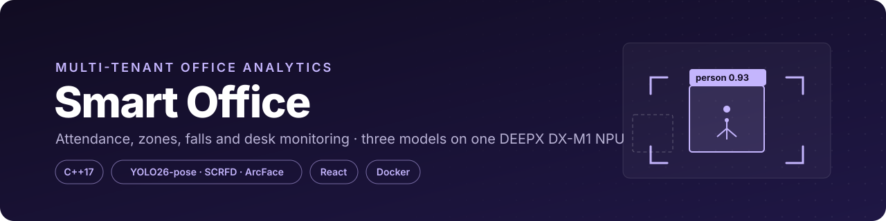
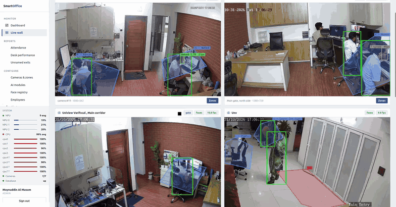
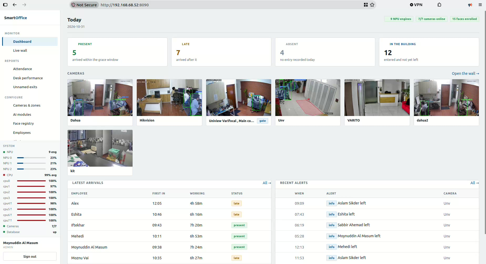
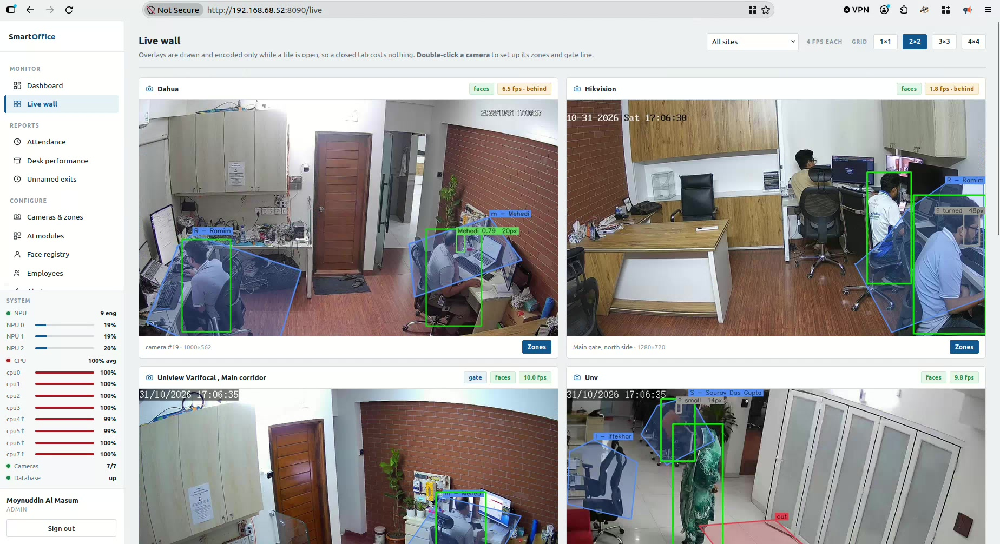
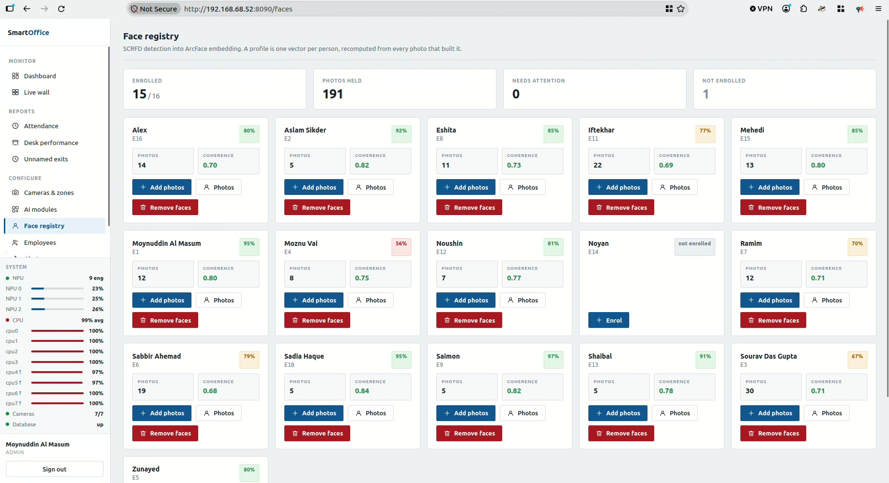
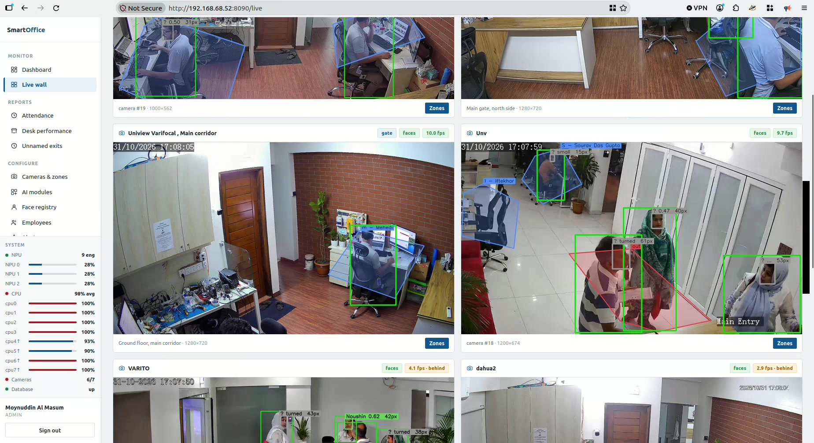
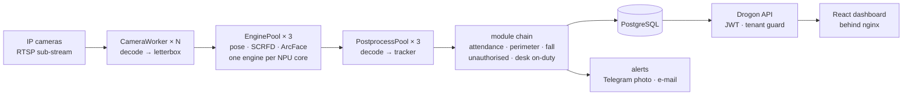

<p align="center">
  
</p>

<p align="center">
<b>Multi-tenant office analytics on a DEEPX DX-M1 NPU.</b><br>
Face-recognition attendance, restricted-zone alerts, fall detection, unauthorised-person detection and desk-wise on-duty monitoring — one C++ binary, three models, three NPU cores, shipped in Docker.
</p>

<p align="center">
  
  
  
  
  
  
</p>

<p align="center">
  
</p>

<p align="center">
  <a href="docs/media/demo.mp4"><b>▶ Full demo video</b></a> &nbsp;·&nbsp; <a href="#screenshots">Screenshots</a> &nbsp;·&nbsp; <a href="#architecture">Architecture</a> &nbsp;·&nbsp; <a href="#quick-start-summary">Quick start</a> &nbsp;·&nbsp; <a href="#documentation">Documentation</a>
</p>

---

## ✨ Highlights

| Highlight | Details |
|---|---|
| 👥 **Five AI modules, one binary** | Attendance (first in, last out, breaks, late / early / absent), Perimeter, Fall (posture from 17 keypoints), Unauthorised person and Desk on-duty |
| ⚡ **2.6× NPU throughput** | `NPU_ALL` does not spread one engine over three cores, so every model is loaded once per core: 71.8 → 186.4 inferences/s on the DX-M1 |
| 🎞 **Decode 33× faster than the hardware decoder** | on this board software decode runs 223.5 fps against 6.7 fps for `mppvideodec` on 640×360 sub-streams; scaling before converting takes 1080p from 27.3 to 66.7 fps |
| 🔔 **Alerts with a photo** | Telegram photos and e-mail with the image attached — the picture is the point, so neither channel sends text alone |
| 🏢 **Multi-tenant by design** | the tenant comes from the token, a SuperAdmin cannot read inside a tenant, passwords are PBKDF2-HMAC-SHA512 at 210 000 iterations, snapshots are served through an authorised handler |
| 🧬 **A face registry that checks itself** | per-profile coherence and quality scores, duplicate-profile warnings and a guided 20-pose capture |
| ✅ **143 tests, 1 887 assertions** | the same suite runs as a gate inside `docker build` and as on-hardware verification |

<a id="screenshots"></a>

## 🖼 Screenshots

<table>
  <tr>
    <td width="50%"><br><sub><b>Dashboard</b> — today's attendance, camera thumbnails, NPU and CPU load</sub></td>
    <td width="50%"><br><sub><b>Live wall</b> — people, faces and zones drawn on every camera</sub></td>
  </tr>
  <tr>
    <td width="50%"><br><sub><b>AI modules</b> — what runs on each camera and why a module is silent</sub></td>
    <td width="50%"><br><sub><b>Recognition in action</b> — face size and match score per face</sub></td>
  </tr>
</table>

<sub>Frames from the demo video (<a href="docs/media/demo.mp4">docs/media/demo.mp4</a>).</sub>

<a id="architecture"></a>

## 🏗 Architecture at a glance



## 🧰 Tech stack

| Layer | Technology |
|---|---|
| **Core** | C++17 · DEEPX DXRT · OpenCV · GStreamer · Drogon (HTTP / WebSocket) |
| **Models** | YOLO26-pose (person boxes + 17 keypoints) · SCRFD-10G (faces + landmarks) · ArcFace MobileFaceNet (512-D embeddings), compiled to `.dxnn` |
| **Data** | PostgreSQL 16 · libpq pool · tenant-scoped repositories · SQL migrations |
| **Frontend** | React 18 · TypeScript · Vite |
| **Deployment** | Docker Compose (nginx, app, postgres) — the image carries no NPU driver and talks to the host's `dxrtd` |
| **Notifications** | Telegram · SMTP · retrying outbox |
| **Quality** | doctest — 143 test cases that skip cleanly where a DX-M1 or a decoder is absent |

<a id="quick-start-summary"></a>

## 🚀 Quick start

```bash
cp .env.example .env          # fill in DB_PASSWORD and JWT_SECRET
./setup.sh                    # checks the board, copies models + the DXRT runtime, builds the image
./run.sh                      # starts everything and waits until it is healthy
```

Then open **http://localhost:8090**. Details follow in the documentation below.

<a id="documentation"></a>

## 📚 Documentation

## Quick start

```bash
cp .env.example .env          # then fill in DB_PASSWORD and JWT_SECRET
./setup.sh                    # checks the board, copies models, builds the image
./run.sh                      # starts everything and waits until it is healthy
```

Open **http://localhost:8090** and sign in with `SEED_ADMIN_EMAIL`.

```bash
./verify.py                   # 12 checks, exits non-zero if any fails
docker compose logs -f app
docker compose down
```

---

## What it does

| Module | What it decides | What it will not do |
|---|---|---|
| **Attendance** | first in, last out, every in/out pair, time actually inside, break time, late / early / absent | name an anonymous crossing, or present an inferred departure as an observed one |
| **Perimeter** | someone standing inside a drawn zone for 1.5 s | fire because a tall person's box overlapped the zone they walked past |
| **Fall** | posture from 17 keypoints, held — then escalating to "needs help" | call a seated person fallen |
| **Unauthorised** | a face was seen and matched nobody | call someone unauthorised when it never got a look at their face |
| **Desk on-duty** | time at a desk zone bound to one employee | silently credit the wrong person when a different face is recognised there |

Alerts go out as **Telegram photos** and **email with the image attached** — the
picture is the point, so neither channel sends text alone.

---

## How it is put together

```
nginx :8090 ──► smart_office :8080                     postgres :5433
                ├── Drogon HTTP/WS · JWT · tenant guard · serves the React SPA
                ├── CameraWorker × N   decode → letterbox → NPU → modules
                ├── PostprocessPool(3) tensor decode → tracker → module chain
                └── EnginePool × 3     pose / scrfd / arcface,
                                       each loaded once per NPU core
```

Two threads per camera (decode, dispatch) plus a shared pool of three
postprocess workers — eight cameras cost nineteen threads, not twenty-four.

---

## Three things that were measured, not assumed

Each of these changed the design. The numbers are from this board.

### 1. `NPU_ALL` does not use three cores

```
1 engine  (NPU_0)         71.8 inf/s    cores at 93.5 /  0.0 /  0.0 %
3 engines (NPU_0/1/2)    186.4 inf/s    cores at 97.6 / 92.8 / 92.8 %
                                        speedup 2.60x
```

`InferenceOption::NPU_ALL` grants a job access to all three cores; it does not
distribute one engine's job stream among them. Per-core binding is the only
mechanism, so every model is loaded three times and jobs go round-robin.

DX-RT also refuses to create a core-bound engine for a model that already has an
`NPU_ALL` engine open, so the process never creates one — for any model, ever.
`tools/bench_pool` re-measures this on demand and `verify.py` runs it.

### 2. On this board, software decode beats the hardware decoder by 33x

```
640x360 sub-stream    mppvideodec        6.7 fps   149.4 ms/frame
                      avdec_h264       223.5 fps     4.5 ms/frame
```

`mppvideodec` is fast in isolation — 94.6 fps decoding 1080p to a fakesink — and
collapses the moment anything reads its buffers on the CPU, because its output
is uncached DMA memory. This application must have BGR in host memory for
OpenCV and for the NPU input tensor, so software decode wins by a wide margin.
`mppvideodec ! video/x-raw,format=BGR` additionally negotiates and then delivers
**zero frames**, which is exactly the silent failure the reader's
prove-a-first-frame probe exists to catch — and it caught it.

Scaling before converting matters as much: the colour conversion cost tracks
output pixels, so the reader caps delivered frames with a caps *range*
(`width=[1,960]`), which leaves a sub-stream untouched and takes 1080p from
27.3 to 66.7 fps.

**Consequence for the deployment:** none of the RKMPP device nodes, none of the
`video`/`render` groups, and no `apparmor=unconfined` — a much smaller privilege
surface than a hardware-decode container needs.

### 3. The SCRFD anchor sits at the cell origin, not its centre

96 paired samples across the clip corpus, comparing SCRFD's own nose *landmark*
against the pose model's nose *keypoint*, normalised by eye separation:

```
cell offset 0.0    median error 0.2364 eye-widths
cell offset 0.5    median error 0.9737 eye-widths    (4.1x worse)
```

Half a stride is 16 px at stride 32 — about one eye-width on these faces — and
it would corrupt the Umeyama alignment and therefore every embedding, quietly.

---

## The sub-stream decision, and what it costs

Every camera decodes its **sub-stream** by default. That is where the capacity
comes from: 4.5 ms per frame instead of 50, so one core can feed over 200 fps of
decode and the NPU becomes the busy part of the system.

Face recognition is the one thing that pays for it. Identification needs roughly
60 px of face, and a face is about 1/7.5 of standing height:

| Gate sub-stream | 450 px person is… | Face recognition |
|---|---|---|
| 640×360 | taller than the frame | **impossible at any distance** |
| 720×576 | 78% of frame height | only head-and-shoulders framing |
| **1280×720** | **62% of frame height** | **works at a door-mounted camera, ~2 m** |

So a gate camera's sub-stream must be set to **1280×720 in the camera's own web
interface** — still an order of magnitude cheaper than its main stream. The UI
refuses to accept a gate camera below that and says which of the two fixes to
apply. Area cameras need bodies, not faces, and are unaffected.

---

## The face registry

A profile is **one vector per person**, recomputed from every photo that built
it — and the photos are kept, because a bad profile is repaired by deleting two
of them, and because the agreement *between* them is the only signal that says a
profile is bad at all.

| Number | What it means | Healthy |
|---|---|---|
| **Coherence** | median pairwise cosine between a profile's OWN photos | ≥ 0.62; below 0.50 is a failure |
| **Quality** | mean per-photo score, anchored at 80 px = 50 and 160 px = 100 | ≥ 80 |
| **Images** | photos held; a NEW profile needs at least 5 | 5–30 |

Coherence is the one that matters and the one nothing else surfaces. A profile
can hold a full set of photos, every one scored 80–97, and still be of two
different faces — and averaging disagreeing vectors produces a profile pointing
at the *middle of the registry* rather than at its owner. It then wins the
argmax against any face too poor to look like anybody in particular. On the
sibling project's registry the 0.40-coherence profile was proposed for 6 of 8
tracked people on a real recording and outscored the right person on his own
face, 0.59 to 0.54. Nothing visible said anything was wrong.

Enrolment also warns when two different people's profiles sit within 0.50 cosine
of each other: two profiles that close cannot be told apart by any threshold, so
the match flips between them frame to frame.

**Guided capture** walks a person through twenty spoken poses, one photo each,
about thirty seconds. Twenty rather than six because the profile describes only
the angles it was given — six near-frontal shots produce someone who is
recognised at the door and missed three steps later. Every prompt is worded
differently on purpose: hearing "turn left" twice makes a person think the
capture stalled and hold still, which is the duplicate frame the spread exists
to avoid. A photo that fails the gate is coached ("come a little closer") and
the pose is asked for again. The preview shows detection boxes so the person can
see a face is being found; what is *captured* is a clean frame, because a box
drawn over a face would otherwise become part of the embedding.

### When it will not identify anybody, and how you find out

Identification needs roughly **60 px of face** in the 640-pixel canvas the
recogniser works in. Measured on a wide-angle office camera in this deployment:

```
det_score   median 0.798   68% clear the gate
|yaw|       median 0.113   79% clear the gate
face_px     median 18.7     2% clear the gate      <- the wall
all three together                0.4%
```

That camera detects faces all day and identifies nobody, and it is *right* to:
naming somebody from 19 px of face would be a guess. What matters is that the
system says so rather than being silently quiet. The AI-modules page reports the
measured average per camera:

> faces on this camera average 21 px and identification needs about 60 — the
> camera is too far from where people pass

## Models

Three, in `models/`:

| Model | Input | Used for |
|---|---|---|
| `yolo26s_pose.dxnn` | `[1,640,640,3]` uint8 | person boxes **and** 17 keypoints, one class |
| `scrfd_10g.dxnn` | `[1,640,640,3]` uint8 | face boxes + 5 landmarks |
| `ArcFace_MobileFaceNet.dxnn` | `[1,112,112,3]` uint8 | 512-D embedding |

A separate 80-class detector is deliberately **not** loaded: the pose model
already emits person boxes, so every module reads one model's output per frame
and fall detection costs nothing extra.

The decoders are ours, not `dx_app`'s — its `YOLOv26PostProcess` selects box
tensors on `shape()[1] == 64` (a DFL head) and assumes 80 classes, while this
export is 4-channel direct regression with a 1-channel person head, so it finds
nothing. Both decoders are verified against captured ground truth rather than
written from memory: `tools/dump_fixtures.py` runs a frame through each model
twice (once with the tail fused on the CPU by ONNX Runtime, once natively) and
the C++ decode of the raw head must reproduce the fused rows **exactly**.

---

## Security

- **No anonymous fallback.** `verify_token` returns an optional and has no
  branch that invents a user. Every route except `/api/auth/login` and
  `/healthz` refuses a caller without a token, and `verify.py` checks that by
  actually calling them.
- **The tenant comes from the token**, never from a request body or query
  string. Every tenant-scoped repository method takes `TenantId` as its first
  parameter with no overload without it, so forgetting the filter does not
  compile.
- **A SuperAdmin cannot read inside a tenant.** They provision and suspend
  companies; they do not browse a client's faces. That is a decision, enforced
  in `may_access_tenant`, not an accident of role checking.
- **Passwords** are PBKDF2-HMAC-SHA512 at 210 000 iterations, with the
  parameters stored alongside each hash so the cost can be raised without
  locking anybody out. Not bcrypt: it truncates at 72 bytes, silently.
- **Secrets have no defaults.** The stack refuses to start without
  `JWT_SECRET` and `DB_PASSWORD`.
- **Snapshots are not static files.** They are partitioned per tenant and served
  through an authorised handler that refuses any path outside the caller's own
  tenant prefix.

---

## Layout

```
src/core/      engine pool, camera reader, postprocess pool, camera worker
src/vision/    YOLO26-pose and SCRFD decoders, ArcFace, geometry, tracker
src/identity/  versioned gallery, quality-weighted face identifier
src/modules/   the five product modules
src/domain/    attendance roll-up (pure, heavily tested)
src/db/        libpq pool, tenant-scoped repositories, migrations
src/api/       auth, guards, six controllers
src/notify/    Telegram, SMTP, snapshot store, retrying outbox
src/app/       the engine that joins vision to the database
frontend/      React + Vite dashboard
tests/         143 tests
tools/         fixture generator, NPU and decode benchmarks
```

## Tests

```bash
cmake -S . -B build -DCMAKE_BUILD_TYPE=Release && cmake --build build -j4
./build/tests/so_tests
```

**143 test cases, 1887 assertions.** Tests that need a DX-M1 or a video decoder
*skip* where those are absent — the same suite therefore runs as a gate inside
`docker build` and as on-hardware verification here. A skip says "not checked
here"; a failure would say "this is broken", and a build that confuses the two
teaches everyone to ignore it.

## Ports

| Service | Port |
|---|---|
| **nginx — start here** | **8090** |
| app | 8080 |
| postgres | 5433 |

## Troubleshooting

**`sanity_check.sh` fails but the NPU is fine.** It needs `sudo`; in a
non-interactive shell that alone makes it fail. Check the hardware directly —
`lspci -d 1ff4:`, `dxrt-cli -s`, `systemctl is-active dxrt.service` — which is
what `setup.sh` and `verify.py` do.

**A camera sits at 0 fps.** Its decode path produced no frames. The reader
proves a first frame before accepting a path and logs which one won; look for
`[camera] … online via …`. A hardware decode failing silently is why that probe
exists.

**Nobody is being recognised at the gate.** Check the camera's sub-stream
resolution. See "The sub-stream decision" above — below 1280×720 there is no
threshold that makes it work.

**Engine creation fails with `Dynamic IPC task init failed`.** Another process
on this board holds an NPU core, or holds the same model with a different
binding. Lower `NPU_CORES` in `.env` to leave it a core.

---

## 👤 Author

**Moynuddin Al Masum** — AI Engineer (Computer Vision) at SmartData Technologies

[](https://moynuddin780.github.io)
[](https://www.linkedin.com/in/moynuddin-al-masum-683102375)
[](https://github.com/Moynuddin780)

## 📄 Licence and third-party notice

No open-source licence is granted yet — **all rights reserved**. Please get in touch before reusing the code.

The DEEPX runtime (DXRT) and the compiled `.dxnn` models are **not** part of this repository and remain subject to DEEPX's and the model authors' own terms.
